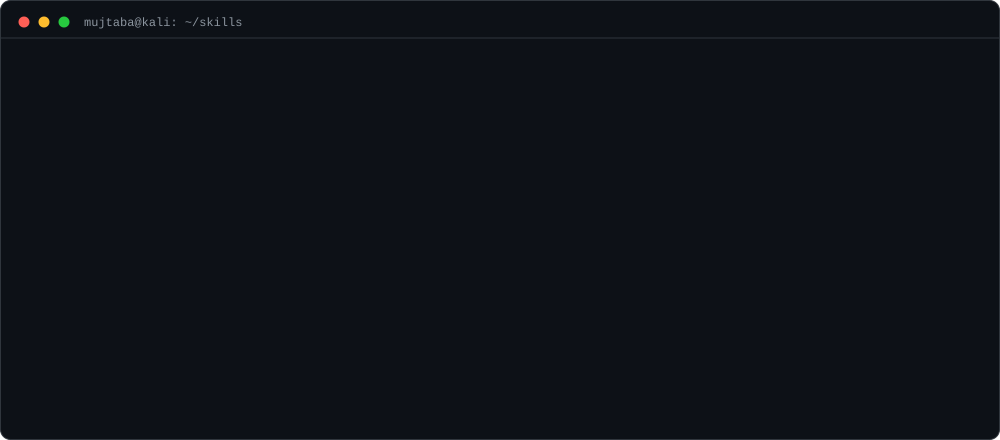

 

  

 

## `$ nmap -sV --script=skills mujtaba.local`

  

 

## `$ cat ctf_log.txt`

  

 

## `$ ls ~/projects`

| Project | What it is |
| :-- | :-- |
| **MalTrack** | Malware incident response management system. C# WinForms + MSSQL backend |
| **Keylogger Detector** | Python tool that detects keylogger activity |
| [**Encryption-Decryption**](https://github.com/Mujtaba11Riu/Encryption-Decryption-) | C++ Caesar Cipher encrypt/decrypt with a colorful console UI |
| [**Portfolio**](https://syedmujtaba.dev) | Personal portfolio and write-ups |

<!-- Repo bante hi MalTrack aur Keylogger Detector ke links yahan add kar dena:
     [**MalTrack**](https://github.com/Mujtaba11Riu/<repo-name>) -->

 

## `$ ./contribution_snake`

  <picture>
    <source media="(prefers-color-scheme: dark)" srcset="https://raw.githubusercontent.com/Mujtaba11Riu/Mujtaba11Riu/output/github-snake-dark.svg" />
    <source media="(prefers-color-scheme: light)" srcset="https://raw.githubusercontent.com/Mujtaba11Riu/Mujtaba11Riu/output/github-snake.svg" />
    
  </picture>

 

  

